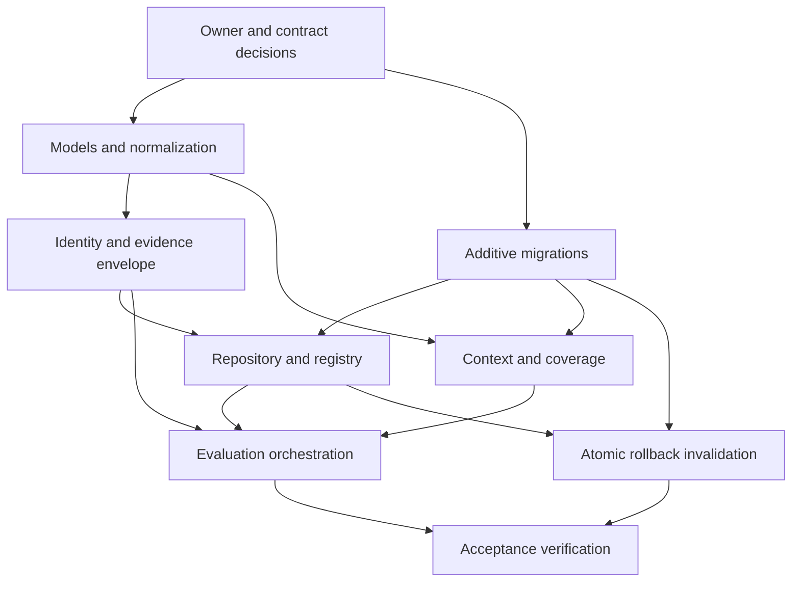

# ORBIS M4.1 — Rule Contracts and Persistence Implementation Plan

**Status:** Implemented and verified for M4.1. See `docs/M4_1_VERIFICATION_REPORT.md` for preflight, migrations, tests and limitations.
**Baseline:** `docs/M4_SPECIFICATION.md`, the approved-as-is PRD PDF, and D-001–D-023 in `docs/DECISIONS.md`.

## 1. Existing architecture assessment

### Persistence and transactions

The project is a Python modular monolith. PostgreSQL is authoritative for indexed chain and M3 knowledge data; `psycopg` 3 is used directly with row dictionaries and repository-owned SQL. `PostgresStore` opens a connection in autocommit mode and uses `self.db.transaction()` around block commits, migrations, enrichment pages, and suffix rollback. There is no ORM or external migration framework. `migrate()` creates `schema_migrations`, sorts `*.sql` filenames lexically, and applies each unapplied file and ledger insert in one transaction. Existing migrations are numbered `001` through `008`, are additive/forward-only, and are exercised in fresh per-test schemas.

`Indexer` depends on a small persistence protocol (`checkpoint`, `block_hash`, `commit_block`, `rollback_from`). It detects reorgs by comparing checkpoint/parent hashes and delegates suffix rollback to the store. The SQLite adapter remains useful for observer tests but does not include PostgreSQL knowledge tables; M4 persistence and rollback integration therefore belong to the PostgreSQL implementation. Rule and evaluation APIs should be service/repository layers over the existing store connection, not new connections with separate commit boundaries.

### Network isolation and source data

`networks.chain_id` is unique. Blocks, transactions, receipts, logs, entities, observations, relationships and evidence references carry `network_id`; composite FKs protect source consistency and M3 entity/relationship links. Transactions and logs retain normalized block/transaction/log identities and canonical source payload fields. `KnowledgeService` performs address normalization and PostgreSQL retrieval/enrichment. `networks.chain_id` is the current chain identity; M4 should use the existing `network_id` FK as tenant boundary and retain the chain ID in snapshots for portable historical interpretation.

SQLite does not provide M3 network/knowledge parity. M4.1 must explicitly document PostgreSQL as its supported persistence backend; it should not pretend that M4 records can be stored by `SqliteStore`.

### Exact rollback behavior and M4 insertion point

`PostgresStore.rollback_from(chain_id, number)` currently opens one transaction, returns if the network is unknown, then:

1. Selects derived M3 evidence at/after the requested height and removes relationship evidence and evidence refs.
2. Deletes derived observations in the suffix.
3. Recomputes relationship first/last block and distinct supporting-transaction counts from surviving canonical evidence; deletes unsupported relationships and discovered entities.
4. Deletes all `blocks` for the network at/after `number` (cascading transactions, receipts, logs, enrichment progress and source-linked rows subject to the deliberate knowledge cleanup).
5. Repairs the checkpoint to the greatest remaining lower block or deletes it.

All work is inside one PostgreSQL transaction. The integration point is immediately after `network_id` is resolved and before step 1. In that transaction, select the exact `(number, hash)` set from `blocks WHERE network_id=%s AND number >= %s`; identify retained M4 evaluations whose immutable evidence identity rows contain any selected hash; mark them invalidated and insert audit rows before any source rows are deleted. The SELECT and M4 updates must use this same connection and transaction. Exact hashes avoid invalidating a hypothetical evaluation of a different fork at the same height. Suffix rollback is the supported operation; M4 must not advertise non-contiguous orphan invalidation as an observer operation.

Rollback failure currently rolls back the M3 and chain changes together, as tested by an injected `BEFORE DELETE ON blocks` trigger. Adding M4 updates before the existing deletion means that same transaction test can prove source deletion, M4 state change, and invalidation audit all roll back together. Replacement evaluation linkage should be recorded only when the replacement evaluation is created, referencing the invalidated predecessor; rollback itself must not guess a replacement.

### Existing constraints, tests and error conventions

Current indexes target network/block, participant histories, log addresses, evidence provenance, entity and relationship lookup, and ordered enrichment. Existing M3 evidence rows intentionally have restrictive source FKs, and `rollback_from` explicitly removes those first. M4 evidence cannot share those FKs: retained evaluation history must survive source deletion. Existing code raises `ValueError` for invalid input, `LookupError` for missing network/entity, and propagates `psycopg` exceptions for database integrity failures; services should follow this convention and let transaction failures propagate.

`tests/test_postgres_integration.py` is a real-PostgreSQL `unittest` suite gated by `ORBIS_TEST_DATABASE_URL`. It creates a UUID schema, calls `PostgresStore.migrate()`, and drops only that test schema. It already covers constraints, source provenance, network isolation, suffix reorg/replay, M3 recomputation, duplicate enrichment workers, and rollback atomicity. Unit tests live in `test_observer.py` and `test_rpc.py`. Preserve the M1–M3 suite unchanged as regression coverage; add M4 integration cases to the same isolated schema harness.

### Reusable components and compatibility concerns

Reuse the connection/transaction owner in `PostgresStore`, migration ledger/order, `networks` identity, `KnowledgeService` address normalization patterns, psycopg `Jsonb`, current block/transaction/receipt/log persisted fields, and UUID-schema PostgreSQL harness. Do not make M4 findings into M3 observations: M3 observations represent knowledge facts and have legacy nullable `rule_id`/`rule_version`, whereas M4 has independent execution/outcome/canonicality and retained evidence requirements. Keep M4 in dedicated tables.

Compatibility points to settle during implementation: PostgresStore currently exposes its connection publicly; M4 service methods should share it and must not commit independently when called inside a larger transaction. Migrations have no downgrade path. `network_id` is database-local, so snapshots and external identities must use chain ID plus normalized network/subject values, never a bare surrogate. Existing source identifiers are stored as `TEXT` (not bytea); normalize hashes/addresses consistently without rewriting historic source rows. Keep M4 and M3 domain concepts separate while allowing M4 to consume M3 indexed data.

## 2. Proposed module structure

Keep the modular monolith and current `src/orbis` package layout:

```text
src/orbis/rules/
  __init__.py
  models.py             # immutable RuleVersion, EvaluationRequest/Result, Finding, Coverage
  normalization.py      # canonical JSON and parameter/input normalization
  identity.py           # canonical digests and evaluation/finding identities
  registry.py           # version lookup, registration, activation/retirement
  coverage.py           # dimension assessment and rule requirement gate
  evidence.py           # normalized envelope, serialization, digest verification
  repository.py         # rule/evaluation/finding/evidence/invalidation SQL
  evaluator.py          # evaluator protocol only; M4.1 includes no D-01..D-05 evaluators
  service.py            # orchestration and state transitions
```

`PostgresStore.rollback_from` remains the transaction owner for reorgs and calls a small M4 invalidation repository/helper on its existing connection. Avoid importing an evaluator into the observer package: define a narrow invalidation function/service interface that accepts network ID, suffix boundary, and orphaned block hashes. Historical retrieval reads retained M4 tables without requiring live source rows. No queue, API framework, graph database, or new runtime dependency is needed.

## 3. Database schema design

All M4 tables are additive and reference `networks(network_id)` with `ON DELETE RESTRICT` (or no network deletion path) so network deletion cannot erase retained audit history. Cross-M4 references use composite `(network_id, id)` keys. Do not add restrictive FKs from retained evidence/evaluations to `blocks`, `transactions`, `receipts`, `logs`, `entities`, `observations`, or `evidence_refs`; these are rollback-deleted or mutable source/knowledge records. Store source identities as values and snapshot the normalized input itself.

### `rule_versions`

One immutable semantic rule definition per `(rule_id, semantic_version)`.

| Column | Type / contract |
|---|---|
| `rule_version_id` | `BIGINT GENERATED ALWAYS AS IDENTITY PRIMARY KEY` |
| `rule_id` | `TEXT NOT NULL`; stable namespaced identity, e.g. `D-01`, not a version |
| `semantic_version` | `TEXT NOT NULL`; validated SemVer text; no production versions assigned in this plan |
| `definition_digest` | `TEXT NOT NULL`; `sha256:` plus lowercase hex digest of canonical immutable definition |
| `input_schema` | `JSONB NOT NULL` |
| `parameter_schema` | `JSONB NOT NULL` |
| `decoder_requirements` | `JSONB NOT NULL DEFAULT '[]'` |
| `coverage_requirements` | `JSONB NOT NULL`; machine-readable mandatory dimensions/policy |
| `lifecycle_state` | `TEXT NOT NULL CHECK` in `staged`, `active`, `retired` |
| `created_at`, `activated_at`, `retired_at` | `TIMESTAMPTZ`; lifecycle timestamps |
| `created_by`, `lifecycle_reason` | `TEXT`; provenance/audit metadata; no identity assumptions |

Constraints: unique `(rule_id, semantic_version)`, unique `(rule_version_id, rule_id)`, valid digest shape and state/timestamp combinations. App code may insert a definition once and only perform allowed lifecycle transitions. A PostgreSQL trigger must reject UPDATE of identity, version, digest, schemas and decoder/coverage definition; only lifecycle metadata may transition `staged -> active -> retired` under checks. A second update/delete trigger rejects DELETE and direct state reversal. Database role permissions should deny DELETE and unrestricted UPDATE to the application role; trigger remains defense in depth. If lifecycle events need a full append-only history, use an optional `rule_version_events` table rather than mutating definition fields.

### `evaluations`

One deterministic request identity and its latest persisted execution record; completed negative outcomes are first-class rows with zero findings.

| Column | Type / contract |
|---|---|
| `evaluation_id` | `BIGINT GENERATED ALWAYS AS IDENTITY PRIMARY KEY` |
| `network_id` | `BIGINT NOT NULL REFERENCES networks(network_id) ON DELETE RESTRICT` |
| `rule_version_id`, `rule_id` | `BIGINT NOT NULL`, `TEXT NOT NULL`; composite FK to `rule_versions(rule_version_id, rule_id)` |
| `subject_kind`, `subject_key` | `TEXT NOT NULL`; normalized stable subject value (e.g. address), not an entity FK |
| `from_block`, `to_block` | `BIGINT NOT NULL CHECK >= 0`, with `from_block <= to_block` |
| `normalized_parameters` | `JSONB NOT NULL` |
| `parameter_digest` | `TEXT NOT NULL` |
| `context_digest` | `TEXT NOT NULL`; canonical input/context digest |
| `evaluator_build` | `TEXT NOT NULL`; reproducible build/source identity |
| `evaluation_key` | `TEXT NOT NULL`; digest of the identity tuple below |
| `execution_status` | `TEXT NOT NULL CHECK` in `completed`, `failed` |
| `analytical_outcome` | nullable `TEXT CHECK` in `matched`, `not_matched`, `insufficient_coverage` |
| `canonicality` | `TEXT NOT NULL CHECK` in `active`, `invalidated` |
| `coverage` | `JSONB NOT NULL`; complete observed machine-readable assessment |
| `evidence_envelope` | `JSONB NOT NULL`; immutable complete snapshot envelope |
| `evidence_digest`, `digest_algorithm`, `evidence_schema_version` | `TEXT`, `TEXT`, `INTEGER NOT NULL` |
| `diagnostics` | `JSONB NOT NULL DEFAULT '{}'`; bounded, non-sensitive execution metadata |
| `attempt_count` | `INTEGER NOT NULL DEFAULT 1 CHECK (attempt_count > 0)`; if single-row retry is selected |
| `started_at`, `completed_at`, `created_at` | `TIMESTAMPTZ`; request/execution timestamps |
| `supersedes_evaluation_id` | nullable `BIGINT`; optional same-network/rule predecessor via composite self-FK |

Use `UNIQUE(network_id, evaluation_key)` and `UNIQUE(network_id, evaluation_id)`. Checks enforce `failed => analytical_outcome IS NULL`; `completed => analytical_outcome IS NOT NULL AND completed_at IS NOT NULL`; log identity integrity applies to evidence item rows; no invalid block bounds. The evidence envelope and all identity fields are immutable after a terminal execution except canonicality, which changes only via the invalidation path. Prevent direct canonicality reversal from `invalidated` to `active`.

For a clearer failed-attempt audit, prefer a small optional `evaluation_attempts` table keyed by `(network_id, evaluation_id, attempt_no)` holding status, diagnostics and timestamps; the evaluation row then stores the successful/final state. This is an implementation choice to resolve before migration. If omitted, retries of a failed identity must be explicitly modeled (and audited) rather than silently overwriting diagnostic history.

### `findings`

Positive deterministic results only; no placeholder row for `not_matched` or `insufficient_coverage`.

Columns: `finding_id BIGINT GENERATED ALWAYS AS IDENTITY PRIMARY KEY`, `network_id BIGINT NOT NULL`, `evaluation_id BIGINT NOT NULL`, `rule_version_id BIGINT NOT NULL`, `finding_key TEXT NOT NULL`, `result JSONB NOT NULL`, `created_at TIMESTAMPTZ NOT NULL`, and optional `severity TEXT` only if a future approved contract defines it (M4.1 should omit it). Composite FKs enforce same network for evaluation and same version as the evaluation. Unique `(network_id, evaluation_id, finding_key)` prevents duplicate positive results on retries; unique `(network_id, finding_id)` supports downstream composite refs. Check finding only attaches to a completed `matched` evaluation through a deferred constraint trigger or repository transaction validation (ordinary CHECK cannot inspect another row). Findings are immutable and inherit canonicality from the parent evaluation; do not duplicate mutable canonicality on findings.

### `finding_evidence`

Join findings to retained evidence items; no reference to live source tables.

Columns: `network_id BIGINT NOT NULL`, `finding_id BIGINT NOT NULL`, `evidence_ordinal INTEGER NOT NULL CHECK >= 0`, `evidence_digest TEXT NOT NULL`, `source_kind TEXT NOT NULL`, `block_number BIGINT NOT NULL CHECK >= 0`, `block_hash TEXT NOT NULL`, `transaction_hash TEXT`, `log_index BIGINT`, `normalized_input JSONB NOT NULL`, `digest_algorithm TEXT NOT NULL`, `evidence_schema_version INTEGER NOT NULL CHECK > 0`. Primary key `(network_id, finding_id, evidence_ordinal)`; unique `(network_id, finding_id, evidence_digest)`; same-network FK to finding. `log_index` must be nonnegative and require a transaction hash. Evaluation-level envelope retains all consumed inputs, including inputs that yielded no finding; finding evidence identifies the exact subset supporting each positive result.

### `evaluation_invalidations`

Append-only audit for each evaluation invalidation event.

Columns: `invalidation_id BIGINT GENERATED ALWAYS AS IDENTITY PRIMARY KEY`, `network_id BIGINT NOT NULL`, `evaluation_id BIGINT NOT NULL`, `rollback_from_block BIGINT NOT NULL CHECK >= 0`, `orphaned_block_hashes JSONB NOT NULL`, `reason TEXT NOT NULL`, `invalidated_at TIMESTAMPTZ NOT NULL DEFAULT now()`, `rollback_id UUID NOT NULL` (one UUID generated per rollback invocation), `prior_canonicality TEXT NOT NULL CHECK = 'active'`. Unique `(network_id, evaluation_id)` prevents duplicate invalidation while evaluation can transition active only once; if multiple rollback events need audit, uniqueness can instead be `(network_id,evaluation_id,rollback_id)` with a partial unique active invalidation strategy. Use same-network FK to evaluation. Append-only trigger rejects UPDATE/DELETE; app role receives INSERT/SELECT only. Index `(network_id, invalidated_at DESC)`, `(network_id, evaluation_id)`, and evaluate-indexes below.

### Optional supersession

Use `evaluations.supersedes_evaluation_id` with a composite self-FK `(network_id, supersedes_evaluation_id) -> evaluations(network_id, evaluation_id)`. Validate same `rule_id` and subject, and require predecessor invalidated at replacement creation. If self-referential validation is cumbersome, use an append-only `evaluation_supersessions(network_id, predecessor_id, replacement_id, linked_at)` table with unique predecessor/replacement and same-network FKs. Never mutate or overwrite the predecessor.

### Indexes, retention and network strategy

Minimum indexes: `evaluations(network_id, rule_id, subject_kind, subject_key, to_block DESC)`, `(network_id, canonicality, created_at DESC)`, unique evaluation key, `findings(network_id, evaluation_id, finding_id)`, `finding_evidence(network_id, block_hash)`, `evaluation_invalidations(network_id, invalidated_at DESC)`, and rule state lookup. Add JSONB GIN only after actual query patterns justify it. Chain hash values use lowercased canonical text, with input validation at the boundary. Composite network FKs prevent cross-network M4 references; source identities remain plain values to survive rollback. Retain snapshots at least for the life of the evaluation. Any expiry, archive tier, retirement/purge mechanism, and audit retention beyond that minimum need owner approval; implement no age-based purge by default.

## 4. Rule registry and lifecycle contract

Rule identity is stable `rule_id` (`D-01`…`D-05`); semantic version changes whenever deterministic behavior, required inputs, parameter meaning, or coverage policy changes. A canonical definition document contains rule identity, semantic version, human description, input/parameter schemas, decoder requirements and coverage policy. Hash canonical serialized bytes using SHA-256 and store the hex digest. Do not define actual D-01…D-05 evaluator contracts or assign deployable versions in M4.1. Register only approved contract metadata/placeholders once the owner authorizes the milestone; D-03/D-04/D-05 remain `staged` pending their explicit approvals.

Registration is insert-only. Historical lookup by `(rule_id, semantic_version)` returns immutable fields regardless of current lifecycle state. Activation and retirement affect future selection only; old evaluations retain their exact version. The application validates transitions and canonical digest before insert; PostgreSQL triggers and role grants prohibit semantic edits and deletion. Do not rely on application convention alone.

## 5. Evaluation identity, normalization and concurrency

### Canonicalization algorithm

1. Validate network against configured indexed `networks` row; use its `network_id` internally and chain ID in portable context.
2. Normalize subject by kind. EVM addresses must be exactly 20 bytes, lowercase `0x` hex; do not infer wallet/contract ownership. Normalize hashes as 32-byte lowercase hex. Reject malformed values rather than applying lossy cleanup.
3. Validate explicit inclusive `from_block` and `to_block`; never substitute “latest” into identity. Capture canonical block hashes for the bounded context and deterministic requested-input manifest.
4. Validate parameters against the immutable rule parameter schema. Apply documented defaults, normalize addresses/hashes and integer quantities to base-10 integer strings, decimal parameters to normalized decimal strings, and set-like arrays to sorted unique values only where schema says order is semantically irrelevant. Preserve ordered arrays where order matters. Reject NaN/infinity, duplicate keys, unknown parameters, ambiguous numeric formats and values outside schema bounds.
5. Serialize recursively as UTF-8 canonical JSON: Unicode NFC strings, lexicographically sorted object keys, no insignificant whitespace, stable JSON booleans/null, and no floating-point numbers. Use one shared canonical serializer; digest bytes, not PostgreSQL's JSONB textual output.
6. `parameter_digest = SHA256(canonical_json(normalized_parameters))`; `context_digest = SHA256(canonical_json({network_chain_id, subject, bounds, ordered canonical input identities, normalized evaluator input}))`. Include block hashes and every consumed transaction/log identity. Stable context manifest ordering is `(block_number, transaction_index, transaction_hash, log_index NULLS FIRST)`.
7. `evaluation_key = SHA256(canonical_json({network_chain_id, subject_kind, subject_key, rule_id, semantic_version, from_block, to_block, parameter_digest, context_digest, evaluator_build}))`. This follows M4.0's uniqueness requirement, including build identity. Keep algorithm/schema identifiers in the serialized object so algorithm upgrades do not collide silently.

The exact identity payload is immutable once claimed. A new canonical block hash, parameter, semantic rule version, or evaluator build creates a distinct evaluation. Evaluator build must be a reproducible source/build identifier supplied by the caller; do not use a mutable label such as `latest`.

### Idempotency and concurrent workers

Insert/claim with unique `(network_id, evaluation_key)` using `INSERT ... ON CONFLICT ...` and return the existing row when it exists. A transaction-scoped advisory lock is optional if needed for expensive duplicate context assembly; the unique constraint is authoritative. Concurrent workers may both calculate a request, but one evaluation identity wins; the loser fetches the persisted terminal result and does not duplicate findings. Persist findings in the same transaction as completion, with unique `(network_id,evaluation_id,finding_key)`. A worker claim/lease mechanism is out of M4.1 unless a measured need appears; for the modular monolith, row locking and short transactions suffice. Do not hold a DB transaction open during RPC or expensive evaluation.

The retry semantics for `failed` rows need an implementation choice: either retain attempts separately (recommended optional `evaluation_attempts`) and retry under the same identity, or treat failures as terminal identities and require an explicit retry generation in identity. Never silently erase an earlier failure or permit a second concurrent active attempt. Completed `not_matched` evaluations persist with zero findings; incomplete coverage persists `completed / insufficient_coverage`; evaluator exceptions persist `failed` with null analytical outcome and bounded diagnostics.

## 6. Coverage contract

Coverage JSON has a versioned top-level envelope and per-dimension states:

```json
{
  "schema_version": 1,
  "requested_range": {"from_block": 100, "to_block": 120},
  "dimensions": {
    "canonical_continuity": {"state": "complete", "gaps": [], "block_hashes_digest": "sha256:..."},
    "transactions": {"state": "complete", "expected": 20, "observed": 20},
    "receipts": {"state": "complete", "expected": 20, "observed": 20, "successful": 19, "failed": 1},
    "logs": {"state": "complete", "expected": 4, "observed": 4, "provenance": "receipt", "removed": 0},
    "decoder_support": {"state": "partial", "supported": ["erc20_transfer"], "unsupported_count": 2},
    "token_metadata": {"state": "not_applicable", "requirements": []},
    "m3_enrichment": {"state": "unknown", "eligible": 20, "completed": 0},
    "protocol_proxy_support": {"state": "partial", "supported_standards": [], "unsupported": []}
  },
  "assessment": {"sufficient": false, "failed_requirements": ["decoder_support"]}
}
```

Allowed state values are exactly `complete`, `partial`, `unknown`, `not_applicable`; each record may include observed/expected counts, gaps, provenance, supported versions and bounded explanatory codes. `not_applicable` is acceptable only when the rule contract declares the dimension optional. Rule-version `coverage_requirements` lists required dimensions and acceptable states plus any deterministic bounds (e.g. every block in the explicit range has a hash, receipts match all transactions, logs derive from receipt provenance, supported decoder covers every relevant log). Coverage assessment is deterministic and returns sufficient/insufficient with machine-readable failures. Do not equate “no matching row found” with complete coverage. Failed transactions are excluded from successful transfer findings but still count toward transaction/receipt completeness. If any mandatory dimension is partial/unknown or decoder/proxy coverage does not satisfy its declared policy, a completed evaluation must be `insufficient_coverage`, never `not_matched`.

M4.1 defines the contract/assessor only. No five-rule logic, standards allowlists, thresholds or D-05 metrics are introduced.

## 7. Evidence envelope and reproducibility

Persist the full normalized input envelope at evaluation level, including all consumed inputs, not only positive finding witnesses. Suggested version-1 shape:

```json
{
  "schema_version": 1,
  "digest_algorithm": "sha256",
  "network": {"chain_id": 1874, "network_name": "...", "environment": "testnet"},
  "subject": {"kind": "address", "key": "0x..."},
  "requested_range": {"from_block": 100, "to_block": 120},
  "rule": {"rule_id": "D-xx", "semantic_version": "...", "definition_digest": "sha256:..."},
  "parameters": {"normalized": {}, "digest": "sha256:..."},
  "evaluator": {"build_identity": "..."},
  "coverage": {"schema_version": 1, "dimensions": {}, "assessment": {}},
  "items": [
    {
      "network_chain_id": 1874,
      "block_number": 100,
      "block_hash": "0x...",
      "transaction_hash": "0x...",
      "log_index": 3,
      "source_kind": "receipt_log",
      "normalized_input": {"emitter": "0x...", "topics": [], "data": "0x..."},
      "digest_algorithm": "sha256",
      "schema_version": 1,
      "evidence_digest": "sha256:..."
    }
  ],
  "context_digest": "sha256:..."
}
```

`log_index` is null for transaction/block evidence and requires a transaction hash when present. Each item's normalized input preserves all source fields actually consumed, represented in canonical forms (raw integer quantities as decimal strings; byte data as lowercase hex; addresses and hashes lowercase). Source kind identifies block, transaction, receipt, receipt log, or M3-derived context. The snapshot includes chain identity, bounds, rule version/digest, normalized parameters, evaluator build, coverage, and full normalized evaluator input. This allows replay after live source rows are deleted, subject to keeping the evaluator build artifact/source available; define a reproducible source/build retention scheme before claiming exact executable reproducibility.

For each item compute `evidence_digest = SHA256(canonical_json(item without evidence_digest))`, prefix `sha256:`. Compute envelope digest over canonical envelope excluding only the envelope digest field (or store it in a containing DB column); all serialization rules in §5 apply. Store the algorithm and schema version with every digest. Verification reconstructs canonical bytes, checks item digests, then envelope digest and evaluation `context_digest`; any mismatch raises an integrity error and historical retrieval reports corruption rather than returning trusted evidence. Digests detect mutation but do not authenticate the original provider; provenance fields explain the source path, not provider truth.

Keep snapshots immutable in application and via DB trigger/permissions. `finding_evidence` stores the exact positive subset and points to copied normalized fields/digests. No restrictive source FK. Retain for at least evaluation lifetime. Owner approval is required for longer duration, archival tier, deletion/retirement, and evaluator artifact retention.

## 8. Python service boundaries

| Boundary | Responsibility |
|---|---|
| `registry.py` / `RuleRegistry` | Register approved definition metadata, validate digest/version, activate/retire and retrieve exact historical version. |
| `normalization.py` / `ParameterNormalizer` | Schema validation, defaults and canonical normalized JSON; no rule matching. |
| `identity.py` / `EvaluationIdentity` | Stable canonical digest/key construction and comparison. |
| `context.py` / `ContextRepository` | Read bounded canonical source records from existing M1/M3 tables, preserving source provenance; no long-lived transaction across evaluation. |
| `coverage.py` / `CoverageAssessor` | Assemble dimensions and compare with the selected immutable rule version's policy. |
| `evidence.py` / `EvidenceSnapshotter` | Create, serialize and verify immutable evidence items/envelope. |
| `repository.py` / `EvaluationRepository` | SQL persistence for evaluations, attempts, findings, evidence and invalidations, using caller connection/transaction. |
| `evaluator.py` / `RuleEvaluator` protocol | Contract for a deterministic evaluator (`evaluate(context, parameters) -> candidate positives`); M4.1 adds no D-01…D-05 implementations. |
| `service.py` / `EvaluationService` | Validate request, load pinned version, normalize, retrieve context, assess coverage, create identity, orchestrate persistence and idempotent result return. |
| retrieval methods | Return historical evaluation/findings/envelope and verify digests without requiring source joins. |

Avoid binding business services to `PostgresStore` internals beyond its existing `db` connection; prefer a small connection/repository dependency consistent with current `KnowledgeService`. Context retrieval uses the existing `networks`, `blocks`, `transactions`, `receipts`, and `logs` tables and preserves chain/log provenance. Rule APIs do not accept unbounded ranges or implicit latest values.

## 9. Migration sequence

Implemented additive migration sequence:

1. `009_m4_rule_evaluation.sql`: rule versions, evaluation and attempt records, findings, retained evidence projections and invalidation audit tables.
2. `010_m4_integrity_guards.sql`: supersession, invalidation-audit, finding and evidence integrity triggers.
3. `011_m4_terminal_failures.sql`: terminal evaluation result guard.
4. `012_m4_lifecycle_hardening.sql`: lifecycle metadata and immutable evaluation field guards.

The migrations preserve the existing ordered transactional ledger and have been applied to fresh isolated integration schemas and the existing development/test schemas. Migrations 001–008 were not edited.

## 10. Reorganization transaction integration

Add an internal `_invalidate_m4_for_suffix(network_id, number, rollback_id, reason)` call inside `PostgresStore.rollback_from`'s current transaction, after network lookup and before M3 evidence/observation deletion. Resolve orphan hashes from `blocks` for that network and suffix. Query M4 evidence identity rows by `(network_id, block_hash)` and select distinct active evaluation IDs. Under row lock, update only `canonicality='active'` to `invalidated`, set invalidated timestamp/reason if denormalized, and insert one append-only audit row per changed evaluation containing the affected orphan hashes and rollback metadata. Make selection/update/audit idempotent: a repeated rollback finds no source suffix or only already-invalidated rows and inserts no duplicate audit. Preserve envelope/finding rows untouched.

Required semantics: only evaluations with consumed evidence on orphaned hashes invalidate; unrelated active evaluations remain active. The selected evaluation's identity snapshot remains intact. Replacement inputs yield a different context/evaluation key and can supersede an invalidated predecessor only after compatibility validation. Use exact hashes to account for orphaned blocks, though rollback suffix remains the caller contract. On any error in invalidation, source deletion, knowledge retraction or checkpoint repair, PostgreSQL transaction rollback restores all changes. SQLite behavior remains unchanged and is not an M4 persistence target.

Prefer a child evidence-item table (evaluation-scoped) with indexed `(network_id, block_hash)` for efficient invalidation over scanning large JSONB envelopes. The JSONB envelope remains the authoritative immutable full record; the child rows are a queryable identity projection whose digest linkage is verified against the envelope. This is an important addition to the M4.0 suggested tables: exact-hash invalidation should not rely on a sequential JSONB scan. The child rows have no FK to live block/source tables.

## 11. Test and acceptance strategy

### Unit tests

- Immutable rule definition digest and lifecycle transition validation; no undeclared D-01–D-05 behavior.
- Parameter normalization: defaults, integer/decimal/address/hash forms, sorted set-like arrays, preserved ordered arrays, malformed values, duplicate/unknown keys, non-finite values.
- Canonical serializer stability and distinct digests when semantic inputs/build/bounds/hashes differ.
- Stable evaluation key across process order and equivalent normalized requests.
- Coverage state validation, mandatory dimensions, `not_applicable` policy, and refusal to report `not_matched` when required coverage is incomplete.
- Evidence item/envelope digest generation and mutation detection; historical verification does not consult source tables.
- Finding identity stability and positive-only result contract.

### PostgreSQL integration tests

Use the existing isolated UUID schema fixture and `PostgresStore.migrate()`; never use development/live schemas. Verify:

- DB-level immutable rule definition fields, allowed staged/active/retired transitions, and delete rejection.
- Additive migration on fresh and pre-existing M1–M3 schemas; repeated migration startup.
- Composite network FKs reject cross-network rule/evaluation/finding/evidence/supersession links.
- Stable unique evaluation identity; duplicate request returns one evaluation; concurrent transactions creating identical identity yield one row/findings set.
- Completed `not_matched` evaluation persists with zero findings; multiple positives persist with evidence; no synthetic finding for insufficient coverage.
- Failed evaluation has null outcome; retry attempt policy preserves diagnostics without duplicate active work.
- Snapshot/evidence survives deletion of matching canonical source suffix; retained retrieval verifies digest without source joins.
- Invalidation only for evaluations using orphan hashes; unaffected evaluations stay active; repeated rollback creates no duplicate audit; findings and snapshots survive.
- Failure injected after M4 invalidation but during block deletion/checkpoint repair restores source rows, M4 canonicality and audit row count atomically.
- Replacement evaluation links to its invalidated predecessor and has distinct key; cross-network or incompatible predecessor link is rejected.
- Historical reproducibility uses stored envelope, pinned rule version, normalized parameters and evaluator build identity after source deletion.

Retain and run the full existing M1–M3 regression suite as acceptance; the plan does not authorize running tests now. Existing live M3 report is historical and bounded and must not be updated to claim M4 validation.

## 12. Resource and performance considerations

Bound explicit evaluation ranges and enforce a configured maximum item count in the service, with rule-level caps where appropriate. Context retrieval should use indexed block ranges and deterministic ordering, batch rows rather than per-row queries, and avoid loading unrelated receipt payloads. The current `receipts.raw` JSONB may be large; select only normalized needed fields and preserve only consumed fields in snapshots. Evidence volume can dominate storage: compress only if it remains transparently verifiable and implementation complexity is justified; initially use JSONB and digest columns, with measured evidence sizes. Add block-hash identity index for invalidation. Avoid broad GIN indexes absent query evidence.

Keep evaluation CPU-bound work outside DB transactions. Transactionally claim identity, persist snapshots/results/findings and mark completion in short units; if evaluation is long, use an explicit lease/attempt design later rather than holding row locks. No external queue or new dependency is warranted for M4.1. Benchmark bounded representative ranges after implementation authorization; existing local query plan evidence is not an M4 throughput claim.

## 13. Implementation task sequence and dependency graph

1. **I0 — Contract choices and owner decisions:** approve this plan, settle failed-retry model, lifecycle/audit details, evidence retention, build identity source and maximum range policy. No D-03/D-04/D-05 rule semantics are inferred.
2. **I1 — Canonical models/normalization:** dataclasses/types, schema validation and canonical JSON. Depends on I0.
3. **I2 — Identity and envelope:** parameter/context/evaluation digests and evidence generation/verification. Depends on I1.
4. **I3 — Additive migrations:** rule registry, evaluation, attempt (if selected), evidence projections, finding and invalidation tables, DB immutability/network constraints. Depends on I0 and schema review; can proceed alongside I1/I2 after contracts settle.
5. **I4 — Repository/registry services:** SQL persistence, lifecycle, historical lookup, unique idempotency and findings. Depends on I3 and I1/I2.
6. **I5 — Context and coverage services:** bounded M1/M3 retrieval and deterministic coverage assessment. Depends on I1, I3 and approved coverage envelope.
7. **I6 — Evaluation orchestration seam:** evaluator protocol, no concrete rule evaluators, negative/insufficient/failed persistence and retry behavior. Depends on I2, I4, I5.
8. **I7 — Rollback integration:** exact orphan hash selection, atomic invalidation/audit within existing rollback transaction, predecessor linkage support. Depends on I3/I4 and regression tests.
9. **I8 — Verification and acceptance:** unit/PostgreSQL tests, M1–M3 regression, migration upgrade tests, bounded resource profile and review of no-rule scope. Depends on I1–I7.



## 14. Acceptance criteria

M4.1 is acceptable only when:

1. Registry definitions are immutable in Python and PostgreSQL; historical versions remain retrievable and activation cannot rewrite them.
2. Independent execution, outcome and canonicality dimensions obey all constraints, including failed-without-outcome and completed negative with zero findings.
3. Evaluation identity is deterministic and unique over network, subject, rule version, explicit bounds, normalized parameters, canonical context and evaluator build; parallel duplicate requests create no duplicate evaluations/findings.
4. Coverage is machine-readable and a required gap can never become `not_matched`.
5. Full evidence envelopes and finding evidence are digest-verifiable and survive source suffix deletion.
6. M4 invalidation and append-only audit execute atomically with M3/source rollback; unaffected evaluations remain active; replacement evaluations preserve predecessor history.
7. Network-scoped composite constraints prevent cross-network linkage without source FKs that block rollback.
8. Fresh schema and additive upgrade pass, and full M1–M3 tests pass without weakening or deleting prior regression coverage.
9. No D-01–D-05 evaluators, thresholds, allowlists, severity, AI, MeTTa, APIs, or new networks are included in M4.1.
10. Performance and evidence storage are measured on bounded fixtures; no broad-network completeness or production throughput is claimed from M3 live evidence.

## 15. Outstanding owner decisions and risks

### Owner decisions required before relevant implementation

- Approve M4.1 implementation authorization after reviewing this plan (D-023/M4.0 boundary).
- Evidence retention duration, archival and deletion/retirement policy; minimum is evaluation lifetime.
- Whether to retain failed attempts in `evaluation_attempts` (recommended) or define another explicit retry generation policy.
- Evaluator build identity format and how source/build artifacts remain available for replay.
- Maximum request range/evidence item cap and whether a future lease mechanism is needed.
- Whether rule lifecycle transitions need a separate append-only event table and operational actor identity.
- D-01 thresholds/governance; D-03/D-04 standards allowlists; D-05 cohort/metric/minimum-data policy remain deferred in M4.0. M4.1 must not invent them.

### Risks and mitigations

| Risk | Mitigation |
|---|---|
| Large evidence envelopes inflate PostgreSQL storage | Bound ranges, snapshot only consumed normalized fields, measure payloads, approve retention/archive before purge behavior. |
| JSONB digest representation differs from original bytes | Canonicalize in one Python serializer and hash canonical bytes; never hash PostgreSQL JSONB output. |
| Rollback invalidation misses a consumed block | Keep indexed evidence identity projection keyed by network/hash and verify it against immutable envelope digest. |
| New FK blocks suffix deletion | No FK from M4 snapshots to source tables; integration test source deletion with retained evidence. |
| Concurrent workers duplicate expensive work | Unique evaluation key is authoritative; optional short advisory lock; findings unique per evaluation. |
| Retry overwrites failure history or strands a failed unique key | Resolve explicit attempt model before schema finalization; preserve attempt diagnostics. |
| Rule can be silently edited after findings exist | Database trigger and application role grants; immutable digest and historical retrieval tests. |
| M3 and M4 concepts become conflated | Keep dedicated M4 evaluation/finding tables; do not convert findings to M3 observations. |
| Chain source rows are incomplete or pruned | Coverage dimensions gate negative outcomes; snapshots preserve consumed inputs, not missing unseen history. |
| Build is identified but unavailable later | Pin durable source/build artifact retention before asserting executable replay; otherwise claim input/result reproducibility only. |

## 16. Files inspected and execution boundary

Inspected: `docs/M4_SPECIFICATION.md`, `docs/DECISIONS.md`, `docs/IMPLEMENTATION_ROADMAP.md`, `docs/ARCHITECTURE.md`, `docs/M1_VERIFICATION_REPORT.md`, `docs/M2_VERIFICATION_REPORT.md`, `docs/M3_VERIFICATION_REPORT.md`, `docs/M3_LIVE_VALIDATION_REPORT.md`, `docs/ORBIS_PRD_Architecture_Specification_v0.1.pdf`, `src/orbis/observer/postgres.py`, `src/orbis/observer/store.py`, `src/orbis/observer/indexer.py`, `src/orbis/knowledge.py`, `src/orbis/db_migrate.py`, migrations `001`–`008`, `tests/test_postgres_integration.py`, `tests/test_observer.py`, `tests/test_rpc.py`, `pyproject.toml`, and `README.md`.

### Preflight result and implementation disposition

Preflight passed. `git status --short` was captured before edits; the existing modified docs and untracked `docs/M4_SPECIFICATION.md` were preserved. The active branch was `main`, at `ff04bfc` (`Complete M3 knowledge and live validation`), preceded by `cac0206` (`Implement ORBIS knowledge layer`). `PostgresStore.rollback_from` was verified to own one transaction covering source cleanup through checkpoint repair. Its exact-hash invalidation point is after network lookup and before M3 cleanup and block deletion. M4 evidence has no FKs to rollback-deleted source rows. The selected chain identity (`networks.chain_id`), normalized evidence projection and `UNIQUE(network_id,evaluation_key)` provide network isolation and idempotency. Negative outcomes are valid with zero findings.

The approved PRD PDF, M4 specification, decisions, roadmap, architecture, M1–M3 reports and the actual source/migrations/tests were inspected. No P0 architecture conflict was found. The specification's retained-snapshot and rollback requirements are implementable by adding `evaluation_evidence` as a queryable identity projection linked only to retained M4 rows, while keeping the complete immutable envelope on evaluations. The current suffix rollback semantics match the M4 invalidation contract.

The configured targets were inspected without printing credentials: `ORBIS_DATABASE_URL` resolves to `orbis_dev`, `ORBIS_TEST_DATABASE_URL` to `orbis_test`; both are PostgreSQL 18.6, role `orbis_app`, public schema, with migrations 001–008 before this implementation. Additive migrations 009–012 were applied to both via the project runner. Integration tests additionally exercised fresh UUID schemas. No reset/drop/recreate was run on either configured database; the test harness drops only its own generated schema.

Implementation detail decisions: use `evaluation_attempts` for first execution diagnostics, immutable terminal failures (retrying the same failed identity is currently idempotent and does not promote it to success); evaluation keys include chain ID, subject, rule version, inclusive bounds, normalized parameters, context digest and evaluator build. Coverage dimensions are extensible, with absent mandatory dimensions treated as unknown. Exact rule parameter semantics remain owned by each future approved rule contract; no D-01–D-05 evaluators or defaults were added.

No `.env` or dependency changes were made. Full run results, known limitations and working-tree status are recorded in the M4.1 verification report.
